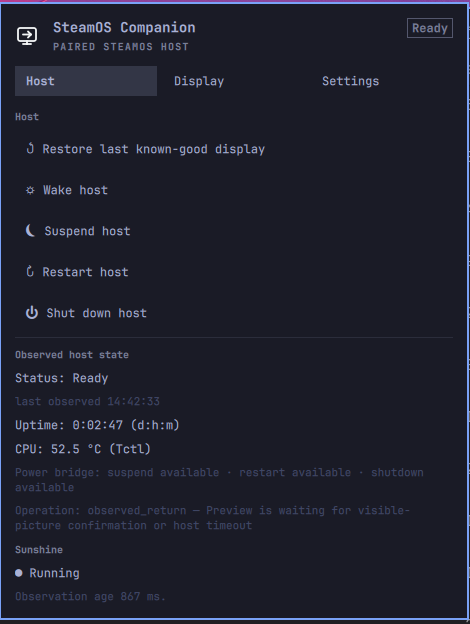
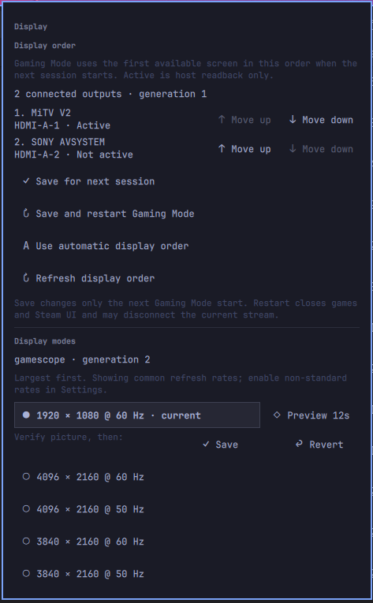
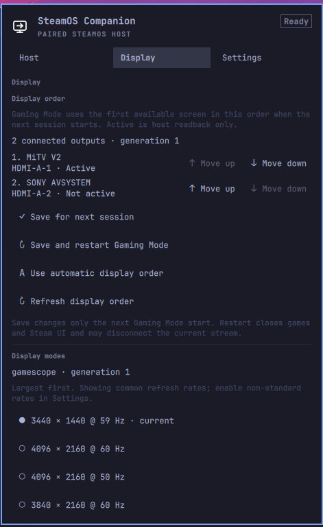
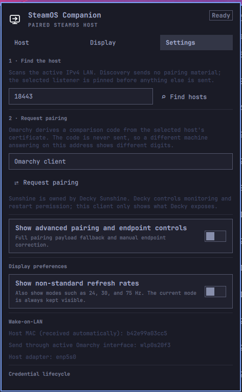

# SteamOS Companion — Omarchy client

SteamOS Companion is a two-client system that shares one v1 protocol:

- **Decky plugin** — runs on SteamOS as a **Client**, **Server**, or **Both**.
- **Omarchy client** — this repository's Linux desktop bar widget and client.

The Omarchy client discovers and pairs with a SteamOS Companion Decky host,
shows its status, wakes it, sends power commands, and provides display recovery.
Sunshine status and restart are shown only when monitoring is enabled on the
host. It pairs with a Decky host in **Server** or **Both** mode.

The Decky host is maintained separately in
[tuthan/steamos-companion-decky](https://github.com/tuthan/steamos-companion-decky).

**Website:** <https://steamos-companion.atas.tech/>

SteamOS Companion is an independent open-source project and is not affiliated with or endorsed by Valve Corporation.

- Plugin ID: `io.github.tuthan.steamoscompanion`
- License: [MIT](LICENSE)

## Screenshots









## Install

Install this client on a Linux desktop running Omarchy from a reviewed checkout
or repository:

```sh
omarchy plugin add https://github.com/tuthan/steamos-companion-omarchy.git --enable
```

The Decky plugin must be installed and running as **Server** or **Both** on the
SteamOS device you want to control before pairing. The Omarchy client is
directory-installed and does not use the Decky ZIP or checksum artifact.

## Pair and use

1. Open the widget’s **Settings** and choose **Find hosts**.
2. Select the intended host, choose **Request pairing**, compare the code with
   the one shown by the Decky plugin, and approve it on the Deck. **Cancel
   pairing request** also asks the host to cancel it; if the host cannot be
   reached the request is still dropped here, the panel says so, and it expires
   on the host within two minutes (reject it in Decky if it is still listed).
3. Use **Host** for status, wake, suspend, restart, and shutdown. Wake reports
   three separate facts as they happen: "Wake packet sent — waiting for host",
   then "Authenticated host response received" with Steam not ready yet, then
   with Steam ready. A sent packet does not show that the host woke. After a
   suspend request, a host that stops answering is shown as "Sleep requested;
   host unreachable", which is not proof that it is asleep.
4. Use **Display** to preview, save, or revert a display mode. When the host
   exposes display-order control, you can also reorder connected outputs, save
   that order for the next session, or save it and restart Gaming Mode after
   confirmation. Everything is reachable from the keyboard (arrows or hjkl move,
   Enter or Space acts), including Preview, Save and Revert of a display preview.
5. Open **Settings → Connection details → Host health** to see what the host
   reports about itself: certificate validity, listener, Steam bridge,
   temperature source, Sunshine, and plugin and protocol versions. It reads the
   status the open panel already polls. A host on an older Decky plugin does not
   report it, and the panel says to update that plugin.
6. On **Display**, selecting a resolution the display link never listed shows an
   advisory above Preview. It only warns: the list comes from the connector
   facts the host reads from the kernel, has no refresh rates, and a resolution
   it omits may still work. **Settings → Connection details → Link facts** names
   the connector behind the display. An older host gets no advisory, and the
   group says the facts are not available.
7. **Settings → Connection details → Host journal** lists the newest operations
   the host recorded for this device, plus the Deck's own display entries, in
   the shared wording of `protocol/operation-vocabulary.json`: what was
   requested, what the host recorded, and when. It is read when Settings opens
   and when you choose **Refresh journal** (no sooner than five seconds after the
   last read), never in the background and never while the panel is closed, and
   it is not stored. An entry records what the host did and read back: a
   completed entry does not by itself show that the picture is visible. A host
   that predates the route, or any failure, shows "The host journal is not
   available from this device." and changes nothing else.
8. **Settings → Connection details → Access on this host** says what the owner of
   the host allows this pairing: **Full access**, **View only**, **No access** or
   **Custom**, then Status, Power and Display as allowed (worded as on the Deck).
   The owner can approve a pairing as view only and change it later on the host,
   and the next status read brings the change here. Power actions and Sunshine
   recovery need Power, and display preview, keep, restore, save current and the
   output order need Display. A control the pairing may not use is disabled with
   the reason beside it, and status, the display list and the journal stay
   available. If the owner removes a scope after you start, the host's refusal is
   shown as "The host owner has not allowed this action for this pairing." and
   nothing is forgotten. If the owner locks remote access on the host, the panel
   sees a refused or timed-out connection, the same as for a host that is off;
   the pairing is kept and works again after the owner unlocks it.
9. **Settings → Forget host** first asks the host to revoke this client's
   credential, then removes the local pairing. If the host cannot be reached or
   refuses, the local pairing is removed anyway and the panel says that the host
   credential stays valid until it is revoked in Decky. **Revoke host
   credential** is the strict form: the local pairing is removed only after the
   host accepts the revocation.

The host listens on all IPv4 interfaces by default. Set its host/IP override
only when it has multiple network interfaces. Sunshine monitoring is disabled
by default and is controlled from Decky settings. When it is disabled, the
client does not show Sunshine controls or request a separate Sunshine poll;
the normal status read remains the source of truth for all remote capabilities.

## CLI evidence tool

The checkout includes an executable `steamos-companion-ctl` wrapper. It uses the
same `ClientCore` and private pairing state as the Omarchy panel, so run it from
a reviewed checkout or the installed plugin directory; it does not create a
second credential store. Global output flags go before the command.

```sh
./steamos-companion-ctl --json pair discover
./steamos-companion-ctl --json pair start --host https://HOST-IP:PORT
./steamos-companion-ctl --json pair poll
./steamos-companion-ctl --json inspect
./steamos-companion-ctl --json diagnostics
./steamos-companion-ctl --json status
./steamos-companion-ctl --json outputs
./steamos-companion-ctl --json display link-facts
./steamos-companion-ctl --json display save-current --output-id OUTPUT_ID --generation GENERATION
./steamos-companion-ctl --json journal list
./steamos-companion-ctl --json journal view
./steamos-companion-ctl --json journal get OPERATION_ID
```

`display save-current` prompts for a typed confirmation after asking the
operator to check the physical picture. In a non-interactive script, first
check that picture and pass both `--yes --acknowledged`; the assertion is still
sent only by this explicit command. A successful response includes the host
operation and read-back profile. Record the operation ID, then use `journal get` to reconcile it. Use `--plain` instead of `--json` for line-oriented human
output. Errors are emitted as a JSON object by default.

`journal list` uses the additive `GET /v1/operations` route, which Decky serves
from `v0.5.18`. An older host can still serve `journal get` but not the list
command. A 404 means the host build does not expose the list route; it is not
acceptance evidence.

`journal view` reads the same bounded journal the panel shows: each record is
rebuilt from an allowlist (no `request_id`, no unknown fields), text loses its
control characters, and only the newest 64 of at most 256 records are kept, with
`total`, `truncated` and `dropped` counts. A host without the route, or a reply
that is not a bounded list, is reported as `"available": false` with an
`unavailable` reason and exit 0. `journal list` prints the host's list as it
came. It reads through the same route-restricted reader, so a full 256-record
journal is accepted (the generic response budget does not apply to this one
route; the 256 KiB body limit still does), and `journal view` is the bounded
form.

Every command that changes the host (`power`, `sunshine recover`, and
`display preview`, `keep`, `revert`, `restore`, `save-current`, `order-save` and
`order-reset`) takes `--request-id ID`: 1 to 128 letters, digits, `.`, `_`, `:` or
`-`, starting with a letter or digit. Without it each run mints a new ID. To
retry a command whose answer was lost, repeat it with the same ID and the same
arguments: while the host still holds the record it returns the original
operation instead of running the command again, and the same ID with different
arguments is refused as a conflict. Choose the ID before the first attempt, and
pass `--preview-id` as well on `display keep` (without it the active preview is
looked up first). Reads, `wake` and `pair` name no host operation and do not
take the flag.

Exit codes: `0` when the command succeeded or only read something, `1` when it
failed definitively (the host refused it, arguments were invalid, the
confirmation was declined), and `2` when the result is unknown: the host
accepted the request but its operation is still `accepted`, `dispatched`,
`observed_return` or `unknown`, or the connection was lost after a write was
sent. On `2`, reconcile with `journal get` or repeat the command with the same
`--request-id` before doing anything else.

`pair cancel` asks the host to cancel the pending request (proved by the
private nonce, with no credential) and always removes the local request. The
result says `acknowledged`, and, when the host did not confirm, carries a
`notice` saying what is left to do in Decky.

`display link-facts` reads the advisory DRM connector facts (resolutions only).
A host without the route, or one that answers badly, is reported as
`"drm": null` with an `unavailable` reason and exit 0, because the facts only
ever feed a warning.

`inspect` output is not for sharing: it prints the host endpoint, host and client IDs and the wake MAC, so use `diagnostics` for anything you paste into an issue.

`status` and `diagnostics` also print an `access` entry beside `data` (with
`--plain`, as the first lines) saying what the owner of the host allows this
pairing, for example `Access on this host: View only · Status`, followed, when
the access is not full, by "The owner of the host chose this and can change it
there." It follows what the host reported, or the scopes saved at pairing when
the host does not report any. `power`, `sunshine recover` and the display
commands that change the host refuse a pairing without Power or Display before
anything is sent, and before they ask you to type YES, with "The host owner has
not allowed Power for this pairing." (or Display). A refusal that has to check
first costs one status read, which also saves what the host says now; the scopes
the host reports replace the saved ones on every status read.

`diagnostics` prints a redacted report of the paired host. It reads status, the
display inventory, the link facts and the operation journal once each, with the
same pinned transport and no retry, timer or write (unlike a status poll it does
not refresh the saved wake target or scopes), and rebuilds only named facts from those
replies by the shared "Diagnostic report" rules in `protocol/README.md`. No MAC,
certificate pin, host or boot ID, address, token, EDID or serial, and no
operation, request, preview or profile ID is copied. Free text (display names,
reasons) loses URLs, pins, MACs, IP addresses, absolute paths and long tokens
and is bounded, and the report stays within 12 KiB by dropping the oldest
journal records first. A route the host does not offer, or any failed read,
leaves that section `null`, which is not the same as an empty one, and the exit
code stays 0. The output is `{"format": "steamos-companion-omarchy-diagnostics-v1",
"generated_at", "client", "local", "report"}` inside the usual `ok`/`data`
object. `client` is the app and its manifest version; `local` is only `paired`,
`scopes` (what the host just reported, else what was saved), `wake_configured`
and `pending_operation_present`, with no endpoint,
identity, pin, MAC, interface or token. Unpaired, it opens no connection and
every report section is `null`. The panel has no export surface: nothing is
sent anywhere, so read the output before you post it.

The wrapper is included in the plugin checkout but is not installed as a
system-wide command by the plugin manager.

## Security

The client requires the system `python3` interpreter and uses only its standard
library. The bundled helper sends credentials only over HTTPS after checking
the paired host's certificate fingerprint. Compare the pairing codes on both
devices before approving a new host.

Credentials and pending requests are stored under
`${XDG_STATE_HOME:-~/.local/state}/steamos-companion` in private files. Symlinked
state directories/ancestors and unsafe shared paths are refused. Network data
and helper output have explicit size limits; oversized responses are rejected.

See the [marketplace feedback review and release checklist](docs/security-review.md)
for the checked patterns, regression tests, and remaining validation limits.

## Local development

Validate the plugin from this directory:

```sh
python3 -m unittest discover -s tests -p 'test_*.py' -v
omarchy plugin validate .
qmllint Panel.qml
```

To install the current checkout for testing, sync it into Omarchy’s real
plugin directory and rescan the shell:

```sh
plugin_dir="$HOME/.config/omarchy/plugins/io.github.tuthan.steamoscompanion"
mkdir -p "$(dirname "$plugin_dir")"
if [ -L "$plugin_dir" ]; then unlink "$plugin_dir"; fi
mkdir -p "$plugin_dir"
rsync -a --delete --exclude='.git/' ./ "$plugin_dir"/
omarchy-shell shell rescanPlugins
omarchy plugin enable io.github.tuthan.steamoscompanion --section right
```

Repeat the `rsync` and rescan commands after changes.

## Upgrading from SteamOS Remote

SteamOS Remote was renamed SteamOS Companion as a clean break: there is no
migration. Disable and remove the old plugin, delete its state directory, install
this client and pair again from **Settings → Find hosts**. Do not copy
credentials or pairings between the old and new names. The Decky host must be
reinstalled the same way; see the Decky repository's upgrade note and
[`docs/decisions/clean-rename.md`](docs/decisions/clean-rename.md).

## Remove

```sh
omarchy plugin disable io.github.tuthan.steamoscompanion
omarchy plugin remove io.github.tuthan.steamoscompanion
```

Removing the plugin does not remove its pairing credentials. Use **Forget
host** in the widget settings first if those credentials should also be
deleted; it asks the host to revoke this client's credential before removing the
local pairing.
